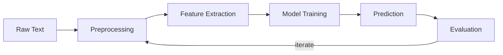

# 🏥 NLP Project — "Help the Doctor" — Complete Analysis & Roadmap

## 1. Executive Summary

Your project is a **multi-class text classification** task in the clinical/medical NLP domain. You must classify medical transcription records into **12 medical specialties**, build at least 3 models, perform data augmentation, and write a 3-page research paper that tells a coherent story around a **research question** you define.

| Aspect | Detail |
|---|---|
| **Task** | Multi-class text classification (12 classes) |
| **Domain** | Clinical / Medical NLP |
| **Training Data** | 2,616 samples across 12 specialties |
| **Test Data** | ~409 unlabelled samples |
| **Deliverables** | `results.txt` (predictions), `NUM.pdf` (3-page paper), code |
| **Deadline** | October 16th, 2026, 23:59 |
| **Max Score** | 4 (automatic) + 16 (paper) = **20 points** |

---

## 2. Project Objectives — The Two Pillars

### Pillar 1: Shared Task Simulation (4 points)

You simulate participation in an NLP shared task / evaluation forum. The scoring works as follows:

| Threshold | Points |
|---|---|
| Accuracy > 49% (beat Naive Bayes + TF-IDF baseline) | **2.0** |
| + No per-class F1 below 25% (model doesn't collapse to dominant class) | **+2.0** |

> [!IMPORTANT]
> The baseline to beat uses **Multinomial Naive Bayes** with TF-IDF features on the `description` field only, with lowercasing and stemming. This means using richer features (e.g., the `transcription` field) and better models should easily surpass it.

> [!WARNING]
> The second criterion (no per-class F1 < 25%) specifically penalises models that ignore minority classes. Given that Surgery alone is ~33% of the data, a naive model could get decent accuracy by always predicting "Surgery" but would fail this criterion. **You must handle class imbalance.**

### Pillar 2: Research Paper (16 points)

Write a short paper (max 3 pages + bibliography + 1-page appendix) following the provided LaTeX template. The paper must:

1. Define a **research question** that guides the entire paper
2. Demonstrate you **looked at the data** (not just numbers)
3. Show **creativity** in model design
4. Be **replicable** — someone should be able to reproduce your results by reading the paper
5. Include a **data augmentation** strategy (mandatory!)

---

## 3. Understanding the Dataset

### 3.1 Training Data (`train.csv`)

- **Format:** Semicolon-delimited CSV (`;`)
- **Rows:** 2,616 data rows (some multi-line due to quoted fields)
- **Columns:** 5

| Column | Description | Avg Length | Missing |
|---|---|---|---|
| `medical_specialty` | **Label** — one of 12 classes | — | 0 |
| `description` | Short case/procedure description | ~200 chars | 4 |
| `sample_name` | Procedure/consultation type name | — | — |
| `transcription` | Full clinical note (free text) | ~2,987 chars | 33 |
| `keywords` | Comma-separated keyword list | ~199 chars | 444 (~17%) |

### 3.2 Class Distribution — Severe Imbalance

```
Surgery                  ████████████████████████████████████ 876 (33.5%)
Cardiovascular-Pulmonary ██████████████ 299 (11.4%)
Orthopedic               █████████████ 292 (11.2%)
Radiology                ██████████ 217 (8.3%)
General Medicine         █████████ 207 (7.9%)
Gastroenterology         █████████ 192 (7.3%)
Neurology                ████████ 181 (6.9%)
Obstetrics-Gynecology    ██████ 135 (5.2%)
Neurosurgery             ███ 78 (3.0%)
Ophthalmology            ███ 71 (2.7%)
Psychiatry-Psychology    ██ 40 (1.5%)
Dermatology              █ 25 (1.0%)
```

> [!CAUTION]
> **Severe class imbalance!** The largest class (Surgery: 876) is **35× larger** than the smallest (Dermatology: 25). The top 3 classes account for ~56% of all data. This imbalance is a central challenge and should inform your research question.

### 3.3 Test Data (`test_no_labels.csv`)

- **Format:** Semicolon-delimited, **no header row**, **no label column**
- **Rows:** ~409 data rows
- **Columns:** 4 (description, sample_name, transcription, keywords)

### 3.4 Data Quality Issues

1. **~3 corrupted rows** in training data where `medical_specialty` contains garbage text (fragments of transcription) — need cleaning/removal
2. **33 empty transcriptions** — the richest text field is missing for ~1.3% of rows
3. **444 empty keyword fields** (~17%) — cannot rely solely on keywords
4. **Some very long descriptions** (max ~32K chars) suggesting parsing anomalies

---

## 4. The Classification Paradigm

### 4.1 What is Text Classification?

Text classification is the task of assigning one (or more) predefined categories to a text document. In your case:

$$f: \text{clinical text features} \rightarrow \{c_1, c_2, \ldots, c_{12}\}$$

where each $c_i$ is a medical specialty. This is:
- **Multi-class** (12 mutually exclusive classes, not binary)
- **Single-label** (each document belongs to exactly one specialty)
- **Supervised** (you have labelled training data)

### 4.2 The Classification Pipeline



**Stage 1 — Preprocessing:** Cleaning, tokenization, lowercasing, stopword handling, stemming/lemmatization, handling missing values.

**Stage 2 — Feature Extraction:** Converting text to numerical representations:
- *Classical:* Bag-of-Words, TF-IDF, n-grams
- *Dense embeddings:* Word2Vec, FastText, sentence embeddings
- *Contextual:* BERT, BioBERT, ClinicalBERT representations

**Stage 3 — Model Training:** Training a classifier on the features:
- *Classical ML:* Naive Bayes, SVM, Logistic Regression, Random Forests
- *Deep Learning:* CNNs, LSTMs, BiLSTMs with attention
- *Transformer-based:* Fine-tuning BERT/BioBERT/ClinicalBERT

**Stage 4 — Evaluation:** Using metrics like accuracy, per-class F1, macro-F1, confusion matrices.

### 4.3 Why This Problem is Hard

1. **Domain-specific language:** Medical text uses specialized terminology, abbreviations, and jargon
2. **Class overlap:** Some specialties share procedures (e.g., Neurology vs. Neurosurgery)
3. **Class imbalance:** Minority classes like Dermatology (25 samples) are extremely under-represented
4. **Noisy labels:** The project description explicitly warns that labels may have errors — "you will find labels you don't agree with"
5. **Multiple input fields:** You must decide how to combine description, transcription, sample_name, and keywords

---

## 5. Phase-by-Phase Work Plan

### Phase 1: Data Analysis & Exploration (feeds §Data Analysis — 1.5 pts)

**Objective:** Deeply understand the data before building anything.

**What to do:**
1. Load and parse the CSV correctly (separator `;`, handle quoting issues)
2. Clean the ~3 corrupted rows
3. Compute class distribution, text length statistics, vocabulary sizes
4. **Look at actual examples** — read several transcriptions per specialty to understand what distinguishes them
5. Identify **at least 2 concrete, non-generic observations**, such as:
   - "Dermatology transcriptions are significantly shorter (avg X chars) than Surgery transcriptions (avg Y chars)"
   - "The keywords field contains specialty-specific terms (e.g., 'knee', 'arthroscopy' for Orthopedic) that could serve as strong signals"
   - "Neurology and Neurosurgery share 15% of their vocabulary, making them hard to distinguish"
   - "33 rows have empty transcriptions — these are concentrated in Radiology (X%) and General Medicine (Y%)"

### Phase 2: Data Augmentation (feeds §Data Augmentation — 2.0 pts)

**Objective:** Increase training data, especially for minority classes.

> [!IMPORTANT]
> Data augmentation is **mandatory**. You must describe your strategy clearly.

**Strategies to consider:**

| Strategy | Description | Best For |
|---|---|---|
| **Oversampling (SMOTE/ADASYN)** | Generate synthetic feature vectors | Classical ML with TF-IDF |
| **Back-translation** | Translate text to another language and back | All approaches, generates paraphrases |
| **Synonym replacement** | Replace words with synonyms (using WordNet or domain-specific thesauri) | Simpler augmentation |
| **LLM-based paraphrasing** | Use GPT/LLaMA to paraphrase minority class texts | High-quality augmentation |
| **Random insertion/deletion/swap** | EDA (Easy Data Augmentation) techniques | Quick baseline augmentation |
| **Class-weighted sampling** | Not augmentation per se, but addresses imbalance during training | All approaches |
| **Contextual word embeddings** | Replace words with contextually similar ones using BERT | Transformer pipelines |

**Recommended approach:** Combine **oversampling of minority classes** with a text-based augmentation technique (e.g., back-translation or synonym replacement). This directly addresses the severe class imbalance and gives you material for the paper.

### Phase 3: Model Development (feeds §Models — 4.0 pts)

**Objective:** Build at least 3 models with increasing sophistication. **This is the highest-weighted section (4 points).**

> [!TIP]
> The scoring rewards **creativity (2.0 pts)** and **replicability (1.0 pts)**. Don't just run code from the internet — make thoughtful choices and document everything clearly.

#### Recommended Model Progression:

**Model 1 — Classical ML Baseline (TF-IDF + SVM/Logistic Regression)**
- Extract TF-IDF features from `description` + `transcription`
- Try combining features from multiple fields
- Train SVM with linear kernel or Logistic Regression (both work well with TF-IDF)
- Use class weights to handle imbalance
- This should comfortably beat the Naive Bayes baseline (>49% accuracy)

**Model 2 — Enhanced Classical or Shallow DL**
- Try n-gram features (bigrams, trigrams) in TF-IDF
- Explore feature engineering: concatenate keyword presence, text length features, sample_name encodings
- Or try a CNN/BiLSTM with pre-trained word embeddings (Word2Vec, FastText)
- Experiment with different field combinations

**Model 3 — Transformer-Based (Fine-tuned BERT or domain-specific variant)**
- Fine-tune a pre-trained transformer model
- Consider domain-specific models:
  - **BioBERT** — pre-trained on biomedical literature
  - **ClinicalBERT** — pre-trained on clinical notes (MIMIC-III)
  - **PubMedBERT** — pre-trained on PubMed abstracts
- Handle long texts: most BERT models have a 512-token limit, but transcriptions average ~3K chars. Strategies:
  - Truncate to first/last 512 tokens
  - Use sliding window with aggregation
  - Use Longformer or BigBird for longer sequences
  - Concatenate description + first N tokens of transcription

**Bonus ideas for creativity:**
- Ensemble methods combining classical + transformer models
- Multi-input architecture (separate encoders for description, transcription, keywords)
- Few-shot or zero-shot classification using instruction-tuned LLMs
- Hierarchical classification (first broad category, then fine-grained)

### Phase 4: Experimental Setup (feeds §Experimental Setup — 1.0 pts)

**Objective:** Define a rigorous, reproducible evaluation framework.

**What to do:**
1. **Split the training data** into your own train/validation/test sets (e.g., 80/10/10 or use stratified k-fold cross-validation to preserve class proportions)
2. **Define evaluation metrics:**
   - Accuracy (required to beat 49%)
   - Per-class F1 (required: all > 25%)
   - Macro-F1 (balances performance across all classes)
   - Confusion matrix
3. **Document hyperparameters** clearly:
   - For TF-IDF: max_features, ngram_range, min_df, max_df
   - For SVM: kernel type, C parameter, class_weight
   - For BERT: learning rate, batch size, epochs, max_length, warmup steps
4. **Use the held-out test set (`test_no_labels.csv`) ONLY for generating `results.txt`** — never for model selection or hyperparameter tuning

> [!WARNING]
> The project description explicitly states: the given test set "should never be used for training." Use your own validation split for model development.

### Phase 5: Results & Analysis (feeds §Results — 1.5 pts and §Discussion — 3.0 pts)

**Objective:** Present results comprehensively and demonstrate deep analysis.

**For Results (1.5 pts):**
- Table with results of all models (at least accuracy, macro-F1)
- Per-class results (precision, recall, F1) for your best model
- A **comprehensive confusion matrix** for one model (clearly labelled)

**For Discussion (3.0 pts — second highest section!):**
- **This section demands qualitative analysis, not just numbers**
- Present at least **3 concrete misclassified examples** from your own test set:
  - Quote the text excerpt
  - State the predicted label vs. correct label
  - **Explain why** the model got confused (e.g., "This Neurosurgery case describes a cranial nerve procedure, but the vocabulary overlaps heavily with Neurology")
- Explain common error patterns (e.g., "Surgery is the most commonly over-predicted class because...")
- Connect results back to your **research question**
- Discuss data quality issues and label disagreements

---

## 6. Research Question — The Story of Your Paper

The research question is the **backbone** of your paper. All sections should connect to it. Here are strong candidates:

| Research Question | Why It Works |
|---|---|
| *"How effective are domain-specific transformer models (BioBERT, ClinicalBERT) compared to classical ML on highly imbalanced clinical text classification?"* | Naturally structures 3+ models (classical → general BERT → domain BERT), gives clear discussion material |
| *"Which data augmentation strategy is most effective for improving minority-class performance in medical specialty classification?"* | Puts augmentation at the centre, compare different strategies, rich ablation study |
| *"Can multi-field feature fusion (combining transcription, description, and keywords) significantly outperform single-field models for medical specialty classification?"* | Tests an interesting hypothesis about using all available fields, easy to structure experiments |
| *"How does model performance vary across medical specialties with different degrees of lexical overlap, and can targeted augmentation close the gap?"* | Sophisticated question linking data analysis to augmentation to discussion |

---

## 7. Report Section-by-Section Scoring Guide

| Section | Points | Key Requirements |
|---|---|---|
| **Introduction** | 1.5 | Define the task AND your research question. The RQ guides the entire paper |
| **Data Analysis** | 1.5 | Class distribution, statistics, **≥2 concrete non-generic observations** |
| **Data Augmentation** | 2.0 | Describe strategy clearly. This is **mandatory** |
| **Models** | 4.0 | ≥3 models (1.0), replicable descriptions (1.0), **creativity** (2.0) |
| **Experimental Setup** | 1.0 | Datasets, splits, metrics, hyperparameters |
| **Results** | 1.5 | Best model results, per-class results, confusion matrix |
| **Discussion** | 3.0 | ≥3 concrete misclassified examples, error analysis, connect to RQ |
| **Future Work** | 0.5 | What you would do with more time, tied to RQ |
| **References** | 1.0 | All sources, models, LLM usage declaration |
| **Total** | **16.0** | |

> [!CAUTION]
> **3 points will be discounted if any instruction is not followed.** This includes: exceeding 3 pages, not following the template, not including data augmentation, wrong file names, etc.

---

## 8. Practical Tips from the Project Description

1. **Pre-processing applied to training data must also be applied to test data** — consistency is critical
2. **Don't blindly remove stop words** — in medical text, words like "no" or "not" can completely change meaning
3. **There is no 100% accuracy** — this is a research problem with noisy labels
4. **Look at the input and output** — not just at numbers (the project description uses **24 exclamation marks** to emphasize this!)
5. **Use formal English** — no contractions, no subjective adjectives
6. **The dataset is adapted from a real Kaggle dataset** — it has real-world noise and errors
7. **Be prepared for an oral discussion** — you must understand everything you submit

---

## 9. Suggested Timeline (8 days to deadline)

| Day | Task |
|---|---|
| **Day 1-2** | Data loading, cleaning, EDA, define research question |
| **Day 3** | Implement data augmentation, build Model 1 (classical baseline) |
| **Day 4-5** | Build Models 2 and 3, tune hyperparameters |
| **Day 6** | Run best model on test set → `results.txt`, generate confusion matrices |
| **Day 7** | Write the paper (all sections), create figures/tables |
| **Day 8** | Review, polish, package submission (NUM.zip) |

---

## 10. Submission Checklist

- [ ] `NUM.zip` file (NOT rar)
  - [ ] `NUM.pdf` — 3-page paper following the template
  - [ ] `results.txt` — predictions for `test_no_labels.csv` (one label per line, no header, matching line numbers)
  - [ ] Project code (not the trained models, just the code)
  - [ ] Any additional datasets gathered
- [ ] Author line includes contribution percentages
- [ ] Paper ≤ 3 pages (bibliography and appendix don't count)
- [ ] Data augmentation is described
- [ ] At least 3 models described
- [ ] At least 3 concrete misclassified examples in Discussion
- [ ] All references cited, LLM usage declared
